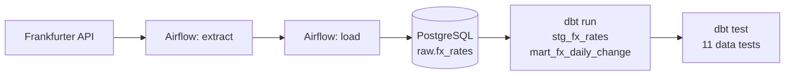

# Batch ETL Pipeline

A daily batch pipeline that ingests USD foreign-exchange rates from a public API, loads them into a PostgreSQL warehouse, and builds tested dbt models on top. Orchestrated with Apache Airflow, fully containerized with Docker Compose, and verified by CI on every push.


## Table of contents

- [Batch ETL Pipeline](#batch-etl-pipeline)
  - [Table of contents](#table-of-contents)
  - [Overview](#overview)
  - [Architecture](#architecture)
  - [Tech stack](#tech-stack)
  - [Data source](#data-source)
  - [Data model](#data-model)
    - [`raw.fx_rates`](#rawfx_rates)
    - [`analytics.stg_fx_rates`](#analyticsstg_fx_rates)
    - [`analytics.mart_fx_daily_change`](#analyticsmart_fx_daily_change)
  - [Design decisions](#design-decisions)
  - [Repository layout](#repository-layout)
  - [Getting started](#getting-started)
    - [Prerequisites](#prerequisites)
    - [1. Clone and configure](#1-clone-and-configure)
    - [2. Generate the Airflow secrets](#2-generate-the-airflow-secrets)
    - [3. Build and start the stack](#3-build-and-start-the-stack)
    - [4. Create the raw table](#4-create-the-raw-table)
    - [5. Run the pipeline](#5-run-the-pipeline)
  - [Configuration](#configuration)
  - [The DAG](#the-dag)
  - [dbt project](#dbt-project)
  - [Testing](#testing)
    - [Data tests (dbt)](#data-tests-dbt)
    - [Unit tests (pytest)](#unit-tests-pytest)
  - [Continuous integration](#continuous-integration)
  - [Verifying the data](#verifying-the-data)
  - [Troubleshooting](#troubleshooting)
  - [Roadmap](#roadmap)

## Overview

Every day, the pipeline:

1. **Extracts** the day's USD exchange rates (EUR, GBP, CNY, JPY) from the Frankfurter API.
2. **Loads** them into a raw table in PostgreSQL using an idempotent upsert.
3. **Transforms** them with dbt into a cleaned staging view and a mart of day-over-day percentage changes.
4. **Tests** the result with dbt data tests. A failing test fails the Airflow task, so bad data is visible instead of silently flowing downstream.

The DAG backfills automatically from its start date, and every step is safe to rerun.

## Architecture



Everything runs in Docker Compose:

| Service | Container | Purpose | Host port |
|---|---|---|---|
| `warehouse` | `etl-warehouse` | PostgreSQL 16, holds raw and analytics schemas | 5433 |
| `airflow-db` | `etl-airflow-db` | PostgreSQL 16, Airflow metadata only | none |
| `airflow-init` | `etl-airflow-init` | One-off job: migrates the metadata DB, creates the admin user | none |
| `airflow-webserver` | `etl-airflow-webserver` | Airflow UI | 8082 |
| `airflow-scheduler` | `etl-airflow-scheduler` | Schedules and runs tasks (LocalExecutor) | none |

The warehouse and Airflow's metadata database are deliberately separate, so pipeline data and orchestration state never mix.

## Tech stack

| Area | Tool |
|---|---|
| Orchestration | Apache Airflow 2.10.5 (LocalExecutor) |
| Warehouse | PostgreSQL 16 |
| Transformations and tests | dbt-core 1.11.11, dbt-postgres 1.10.0 |
| Language and tooling | Python 3.11, uv, pytest, requests, psycopg2 |
| Containers | Docker, Docker Compose |
| CI | GitHub Actions |

## Data source

[Frankfurter](https://frankfurter.dev) publishes European Central Bank reference rates. It is free and needs no API key.

Example request and response:

```bash
curl "https://api.frankfurter.dev/v1/2024-01-02?base=USD&symbols=EUR,GBP,CNY,JPY"
```

```json
{"amount":1.0,"base":"USD","date":"2024-01-02","rates":{"CNY":7.1435,"EUR":0.91274,"GBP":0.79085,"JPY":142.1}}
```

The ECB publishes only on business days. A request for a weekend date returns the previous Friday's rates, with the `date` field set to Friday. The pipeline relies on this behavior (see [Design decisions](#design-decisions)).

## Data model

| Layer | Object | Type | Grain |
|---|---|---|---|
| Raw | `raw.fx_rates` | table | one row per `rate_date`, `base`, `currency` |
| Staging | `analytics.stg_fx_rates` | view | same grain, columns renamed |
| Mart | `analytics.mart_fx_daily_change` | table | one row per date and currency, with day-over-day change |

### `raw.fx_rates`

| Column | Type | Notes |
|---|---|---|
| `rate_date` | date | The date the API returned, not the date requested |
| `base` | text | Always `USD` |
| `currency` | text | Quote currency |
| `rate` | numeric(18,8) | Units of quote currency per 1 USD |
| `source_file` | text | Which run produced the row, e.g. `api:frankfurter:2026-11-01` |
| `loaded_at` | timestamptz | Refreshed on every upsert |

Primary key: (`rate_date`, `base`, `currency`).

### `analytics.stg_fx_rates`

Renames `base` to `base_currency` and `currency` to `quote_currency`. No other changes.

### `analytics.mart_fx_daily_change`

| Column | Notes |
|---|---|
| `rate_date`, `base_currency`, `quote_currency`, `rate` | Carried from staging |
| `previous_rate` | Previous business day's rate for the same currency (`lag` window function) |
| `pct_change` | `(rate / previous_rate - 1) * 100`, rounded to 4 decimals. Null on the first date per currency |

## Design decisions

- **Idempotent loads.** The raw table has a primary key on (`rate_date`, `base`, `currency`) and the loader uses `INSERT ... ON CONFLICT DO UPDATE`. Reruns, retries, and backfills can never create duplicates.
- **Rows are keyed on the returned date.** A Saturday or Sunday run gets Friday's rates back. Keying on the requested date would create duplicates under the wrong dates, so the loader uses the API's `date` field. The `source_file` column keeps the lineage: for example, `2026-10-30` rows carry `api:frankfurter:2026-11-01`, which is the Sunday run that landed on Friday.
- **Logical date drives the run.** Each DAG run fetches the day given by Airflow's `ds`, so backfills and reruns are deterministic.
- **Business-day comparisons.** The mart uses a window function over dates present in the data, so Monday's change is measured against Friday rather than against a nonexistent weekend rate.
- **dbt in its own virtualenv.** dbt is installed at `/home/airflow/dbt_venv` inside the Airflow image, isolated from Airflow's dependencies.
- **Versions pinned.** dbt-core and dbt-postgres versions match between local development, the Docker image, and CI, so a passing test locally means a passing test everywhere.
- **No secrets in the repo.** Credentials come from `.env` (gitignored). `dbt/profiles.yml` reads everything from environment variables, and the Airflow connection to the warehouse is defined through an environment variable (`AIRFLOW_CONN_WAREHOUSE`), so no password is typed into the UI.
- **Extract and load are plain Python.** The logic lives in `airflow/plugins/fx_etl` and is unit-tested without Airflow. The DAG only wires it together.

## Repository layout

```
.
├── airflow/
│   ├── dags/
│   │   └── fx_rates_daily.py     
│   └── plugins/
│       └── fx_etl/
│           ├── extract.py        
│           └── load.py          
├── dbt/
│   ├── dbt_project.yml
│   ├── profiles.yml              
│   ├── models/
│   │   ├── staging/             
│   │   └── marts/                
│   └── tests/                    
├── sql/
│   ├── 001_raw_fx_rates.sql      
│   └── ci_seed.sql               
├── tests/
│   └── test_extract.py           
├── .github/workflows/ci.yml
├── Dockerfile                   
├── docker-compose.yml
├── pyproject.toml
├── .env.example
└── README.md
```

## Getting started

### Prerequisites

- Docker with Docker Compose
- [uv](https://docs.astral.sh/uv/) (only needed to run tests and dbt on your machine)
- `openssl` (to generate Airflow secrets)

### 1. Clone and configure

```bash
git clone https://github.com/aaronGeb/batch-etl-pipeline.git
cd batch-etl-pipeline
cp .env.example .env
```

Open `.env` and fill in the values (see [Configuration](#configuration)). Keep passwords to letters, numbers, and underscores, because they are embedded in connection URLs.

### 2. Generate the Airflow secrets

These commands append the two keys to `.env` without printing them:

```bash
echo >> .env
printf 'AIRFLOW_FERNET_KEY=%s\n' "$(openssl rand -base64 32 | tr '+/' '-_')" >> .env
printf 'AIRFLOW_SECRET_KEY=%s\n' "$(openssl rand -hex 32)" >> .env
```

### 3. Build and start the stack

```bash
docker compose build
docker compose up -d
```

The first build takes a few minutes. `airflow-init` runs automatically, migrates Airflow's metadata database, creates the admin user, and exits. Check that everything is up:

```bash
docker compose ps -a
```

`etl-airflow-init` should show `Exited (0)`. The other containers should be `Up`.

### 4. Create the raw table

```bash
docker exec -i etl-warehouse psql -U etl -d warehouse < sql/001_raw_fx_rates.sql
```

If you changed `WAREHOUSE_USER` or `WAREHOUSE_DB` in `.env`, use those values instead of `etl` and `warehouse`.

### 5. Run the pipeline

Open the Airflow UI at http://localhost:8082 and log in with `AIRFLOW_ADMIN_USER` and `AIRFLOW_ADMIN_PASSWORD`. Unpause the `fx_rates_daily` DAG. Airflow will backfill every day from 2026-11-01, one run at a time, and then run daily.

To test a single day without the scheduler:

```bash
docker compose exec airflow-scheduler airflow dags test fx_rates_daily 2026-11-10
```

## Configuration

All configuration lives in `.env` (gitignored). `.env.example` lists the keys with empty values.

| Variable | Purpose |
|---|---|
| `WAREHOUSE_DB` | Warehouse database name |
| `WAREHOUSE_USER` | Warehouse user |
| `WAREHOUSE_PASSWORD` | Warehouse password |
| `AIRFLOW_DB_PASSWORD` | Password for Airflow's metadata database |
| `AIRFLOW_FERNET_KEY` | Encrypts stored Airflow connections |
| `AIRFLOW_SECRET_KEY` | Signs Airflow webserver session cookies |
| `AIRFLOW_ADMIN_USER` | Airflow UI admin username |
| `AIRFLOW_ADMIN_PASSWORD` | Airflow UI admin password |

Inside the containers, Compose also sets `DBT_HOST=warehouse` and `DBT_PORT=5432`, so dbt reaches the warehouse over Docker's network. On your own machine, `profiles.yml` defaults to `localhost:5433`.

## The DAG

`airflow/dags/fx_rates_daily.py` defines `fx_rates_daily`:

| Setting | Value |
|---|---|
| Schedule | `@daily` |
| Start date | 2026-11-01 |
| Catchup | enabled |
| Max active runs | 1 |
| Retries | 2, with a 2-minute delay |

Task graph:

```
extract >> load >> dbt_run >> dbt_test
```

| Task | What it does |
|---|---|
| `extract` | Calls the Frankfurter API for the run's logical date (`ds`) and returns the JSON payload |
| `load` | Flattens the payload to one row per currency and upserts into `raw.fx_rates` |
| `dbt_run` | Builds `stg_fx_rates` and `mart_fx_daily_change` |
| `dbt_test` | Runs all dbt data tests. Any failure fails the task |

## dbt project

Run dbt from your machine (the warehouse must be running):

```bash
uv sync
set -a; source .env; set +a
uv run dbt run  --project-dir dbt --profiles-dir dbt
uv run dbt test --project-dir dbt --profiles-dir dbt
```

Or run it inside the Airflow container, using the same paths the DAG uses:

```bash
docker compose exec airflow-scheduler /home/airflow/dbt_venv/bin/dbt run  --project-dir /opt/airflow/dbt --profiles-dir /opt/airflow/dbt
docker compose exec airflow-scheduler /home/airflow/dbt_venv/bin/dbt test --project-dir /opt/airflow/dbt --profiles-dir /opt/airflow/dbt
```

Staging models are materialized as views and marts as tables.

## Testing

### Data tests (dbt)

11 tests run after every load:

| Model | Tests |
|---|---|
| `stg_fx_rates` | `not_null` on `rate_date`, `base_currency`, `quote_currency`, `rate`; `accepted_values` on `base_currency` (`USD`) and `quote_currency` (`EUR`, `GBP`, `CNY`, `JPY`) |
| `stg_fx_rates` (singular test) | No more than one row per (`rate_date`, `base_currency`, `quote_currency`) |
| `mart_fx_daily_change` | `not_null` on `rate_date`, `quote_currency`, `rate`; `accepted_values` on `quote_currency` |

`pct_change` is intentionally not tested for nulls, because the first date per currency has no previous rate.

### Unit tests (pytest)

```bash
uv run pytest -q
```

The unit tests cover `flatten_rates`: one row per currency, and rows keyed on the returned date rather than the requested one.

## Continuous integration

`.github/workflows/ci.yml` runs on every push to `main` and on pull requests:

1. Starts a throwaway PostgreSQL 16 service container.
2. Installs dependencies with uv (Python 3.11).
3. Runs the pytest unit tests.
4. Creates the raw table from `sql/001_raw_fx_rates.sql` and loads fixture rows from `sql/ci_seed.sql`.
5. Runs `dbt run` and `dbt test` against the fixture data.

The credentials in the workflow belong to a database that exists only for the duration of the run.

## Verifying the data

Row counts per date (expect 4 per business day):

```bash
docker exec -it etl-warehouse psql -U etl -d warehouse -c \
  "select rate_date, count(*) from raw.fx_rates group by rate_date order by rate_date;"
```

Day-over-day changes for one currency:

```bash
docker exec -it etl-warehouse psql -U etl -d warehouse -c \
  "select * from analytics.mart_fx_daily_change where quote_currency = 'EUR' order by rate_date;"
```

Confirm weekend runs landed on the previous Friday. There should be no Saturday or Sunday in `rate_date`:

```bash
docker exec -it etl-warehouse psql -U etl -d warehouse -c \
  "select distinct rate_date, to_char(rate_date, 'Dy') as weekday from raw.fx_rates order by rate_date;"
```

## Troubleshooting

| Symptom | Cause and fix |
|---|---|
| `The "AIRFLOW_FERNET_KEY" variable is not set` | The keys are missing from `.env` (they may only be in `.env.example`). Generate them as in [step 2](#2-generate-the-airflow-secrets), then recreate the containers with `docker compose up -d --force-recreate`. |
| `cannot use SQLite with the LocalExecutor` | `AIRFLOW__DATABASE__SQL_ALCHEMY_CONN` is missing from the `environment:` block in `docker-compose.yml`, so Airflow fell back to SQLite. Restore the line. |
| `airflow-init` exits with a non-zero code | Run `docker compose logs --tail 20 airflow-init` to see the error. |
| `service ... didn't complete successfully` for the webserver or scheduler | They wait for `airflow-init`. Fix `airflow-init` first. |
| Port already in use | Another stack is using 5433 or 8082. Change the host side of the port mapping in `docker-compose.yml`. |
| dbt reports `Nothing to do` | The model files are not under `dbt/models/staging` or `dbt/models/marts`. |
| dbt YAML parse errors | Indentation. In test definitions, `arguments:` must be nested under `accepted_values:`. |
| `dbt debug` shows `git [ERROR]` inside the container | The Airflow image has no git. dbt only needs git for packages, and this project has none, so `dbt run` and `dbt test` are unaffected. |
| Login fails in the Airflow UI | Use `AIRFLOW_ADMIN_USER` and `AIRFLOW_ADMIN_PASSWORD` from `.env`. |

## Roadmap

Not yet implemented:

- **Amazon S3 landing zone.** Write each day's raw API response to a date-partitioned S3 prefix before loading to Postgres.
- **Terraform.** Provision the S3 bucket and least-privilege IAM roles (a writer role for the pipeline and a read-only role for analysts).
- **Terraform-managed warehouse roles.** Provision database roles for the warehouse.
- **Alerting.** Notify on task or data-test failure.
